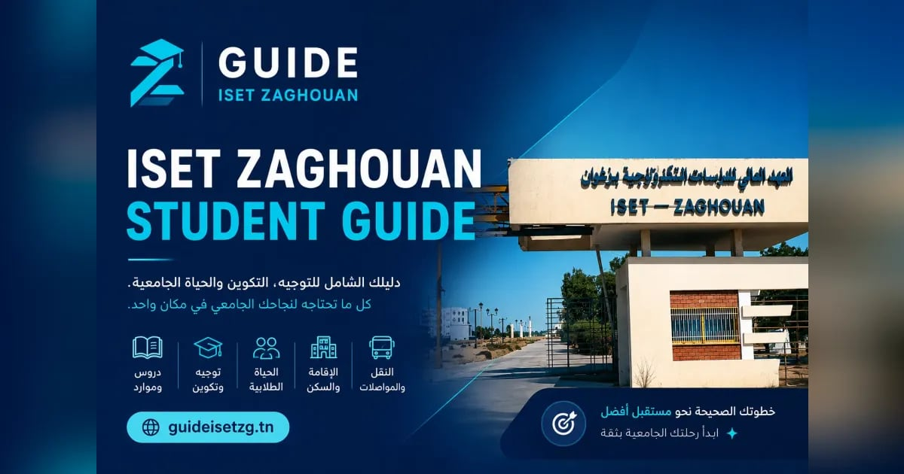
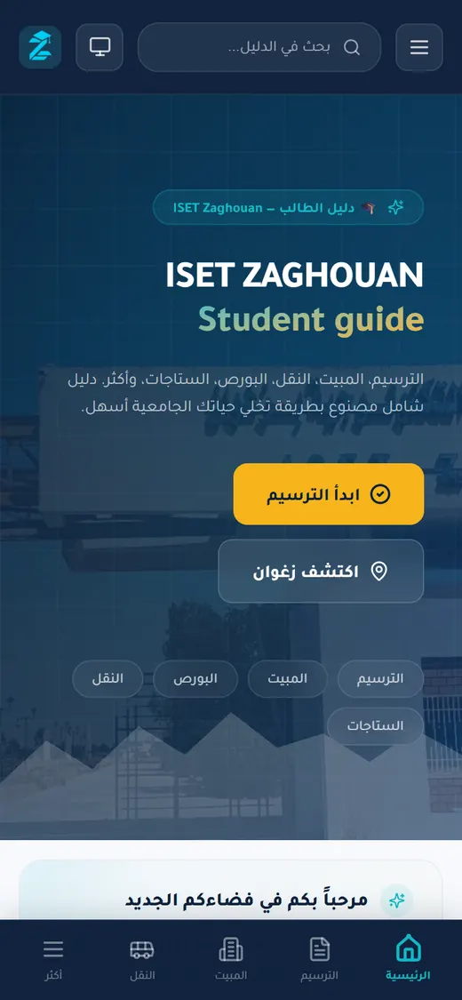
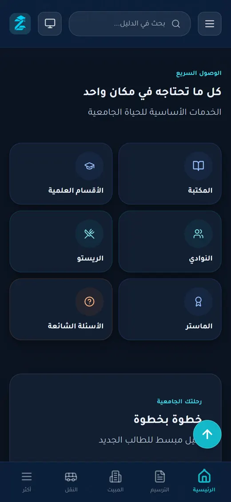
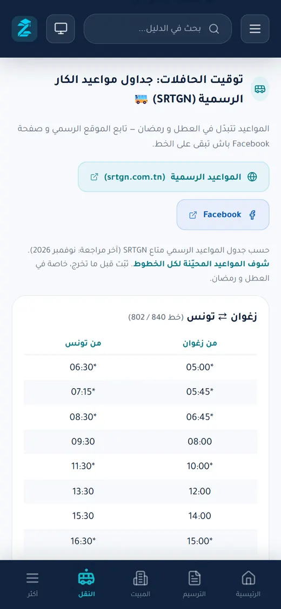
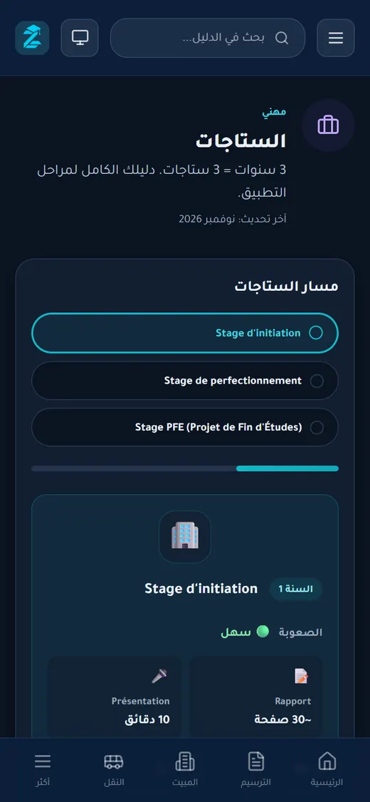

<p align="center">
  <a href="https://guideisetzg.tn">
    
  </a>
</p>

<h1 align="center">Guide ISET Zaghouan</h1>

<p align="center">
  <b>The student guide for ISET Zaghouan, made by students, for students.</b>
</p>
<p align="center" dir="rtl">
  دليل الطالب في ISET Zaghouan: الترسيم، المبيت، النقل، البورص، الستاجات، و كل ما يخص الحياة الجامعية
</p>

<p align="center">
  <a href="https://guideisetzg.tn"></a>
  <a href="https://github.com/jozefelmanga/iset-zaghouan-hub/actions/workflows/ci.yml"></a>
  
  
  
</p>

<p align="center">
  <a href="https://guideisetzg.tn"><b>Open the guide</b></a> ·
  <a href="https://forms.gle/4Aj6svouhdPu9TBA7">Report a problem</a> ·
  <a href="CONTRIBUTING.md">Contribute (العربية)</a>
</p>

---

## Why this exists

Every September, hundreds of new students arrive at ISET Zaghouan and spend their first weeks asking the same questions in Facebook groups: *which papers do I need, where do I catch the bus to Tunis, when is the bourse deadline, how do I get a room in the foyer?* The answers exist, but they're scattered across old posts, office notice boards and word of mouth.

**Guide ISET Zaghouan puts all of it in one place**, written in Tunisian derja the way students actually talk, designed for the phone in their pocket, and working even when the mobile data runs out.

It's an independent student initiative, not the institute's official website ([isetzg.rnu.tn](https://isetzg.rnu.tn)).

## Impact

<table>
  <tr>
    <td align="center"><h3>~1,970</h3>students reached</td>
    <td align="center"><h3>14.8K</h3>page views</td>
    <td align="center"><h3>3 min 42 s</h3>average time on site</td>
  </tr>
  <tr>
    <td align="center"><h3>23.6K</h3>appearances in Google search</td>
    <td align="center"><h3>1,090</h3>visits from Google</td>
    <td align="center"><h3>83%</h3>of visitors on phones</td>
  </tr>
</table>

<sub>Google Analytics and Search Console, 1 January to 19 November 2026.</sub>

## A look inside

<table>
  <tr>
    <td align="center"><br><sub>Homepage</sub></td>
    <td align="center"><br><sub>Dark mode</sub></td>
    <td align="center"><br><sub>Bus timetables</sub></td>
    <td align="center"><br><sub>Internship tracker</sub></td>
  </tr>
</table>

## What's in the guide

**28 pages** covering a student's whole journey, from the first enrollment paper to the graduation project.

| | Pages | What students find there |
|---|---|---|
| 🎓 **Academics** | Enrollment, foyer enrollment, library, departments (TI, SEG, GPR), masters | Step-by-step enrollment with a personal checklist, the exact papers to bring, department programs and career paths |
| 🏠 **Student life** | Housing, resto, bourse, transport | Girls' and boys' foyers with photos, resto hours and tickets, the full bourse paper list and its 15-day deadline, bus timetables Zaghouan ⇄ Tunis, Nabeul and Sousse, louage fares |
| 💼 **Internships** | Stages, PFE, companies | A 3-year internship tracker, a grade calculator, report templates, and a searchable directory of **267 companies** that take ISET interns |
| 🗺️ **Campus and city** | Explore Zaghouan, clubs, FAQ, tips | Study spots and cafés, a photo gallery, **7 student clubs** (SecuriNets, IEEE, Enactus, Robotique, SOS, ProceGenius…), answers to the questions everyone asks |

## Built with care

The guide is small, but it's engineered like a product students can depend on.

- **📱 Phone first.** Designed and tested at 360 to 430 px. Big tap targets, a bottom navigation bar, safe-area support on iPhones.
- **📶 Works offline.** Installable as an app. Every page a student opens is saved on their phone, so the bus timetable still opens on the louage with no signal. When offline, a banner shows the date of the saved copy.
- **🌙 Dark mode.** Follows the phone's setting, or a 3-way switch (auto, light, dark) that remembers the choice, with no flash on load.
- **♿ Accessible.** WCAG AA text contrast on every page in both themes (checked automatically on each change), Lighthouse accessibility 100, proper heading structure, French terms announced in French by screen readers, reduced-motion support.
- **🔎 Findable.** Lighthouse SEO 100 on all 28 pages, structured data (FAQ, breadcrumbs), clean share previews for WhatsApp and Messenger, `llms.txt` for AI search engines.
- **🗣️ Search that speaks derja.** The search box understands كار, سكن, مطعم, تربص, French words like *horaire* or *internat*, Arabic spelling variants (أ/ا, ة/ه, ى/ي) and small typos.
- **⚡ Fast and light.** Static pages with no server, CSS-only animations, gallery thumbnails, analytics loaded only once the page is idle. The homepage loads under 600 KB.
- **✅ One source of truth.** Every fact (papers, deadlines, bus times, fares, resto hours) is written once in `src/data/`. The FAQ is generated from it, and a test fails if a copy ever drifts.
- **🔒 Secure by default.** Static export with no backend or database, strict security headers (CSP, HSTS), no personal data collected.

## Tech stack

| | |
|---|---|
| **Framework** | Next.js 16 (App Router, static export), React 19, TypeScript |
| **Styling** | Tailwind CSS v4, CSS design tokens with light and dark themes |
| **Motion and icons** | Framer Motion (only where it does real work), Lucide |
| **Offline** | Hand-written service worker, web app manifest |
| **Quality** | Vitest (113 tests), ESLint, axe-core, Lighthouse CI, headless Chrome |
| **Hosting** | Vercel, deployed on every push to `main` |

## Getting started

```bash
git clone https://github.com/jozefelmanga/iset-zaghouan-hub.git
cd iset-zaghouan-hub
npm install
npm run dev          # http://localhost:3000
```

Copy `.env.example` to `.env.local` and set `NEXT_PUBLIC_SITE_URL` to your domain (canonical URLs, sitemap, share previews). `NEXT_PUBLIC_GA_ID` and `NEXT_PUBLIC_CLARITY_ID` are optional.

| Command | What it does |
|---|---|
| `npm run build` | Static production build into `dist/` (also regenerates the company list, `llms.txt` and gallery thumbnails) |
| `npm run test` | Unit, component and data-consistency tests |
| `npm run lint` | ESLint |
| `npm run check-bundle` | Homepage JavaScript budget |
| `npm run check-contrast` | WCAG AA contrast on every page, light and dark |
| `npm run check-offline` | Real offline test in headless Chrome |

All of these run in CI on every push, plus a Lighthouse report and a monthly broken-link check.

## Project structure

```
src/
  app/            Pages (Server Components by default)
  components/     UI, layout and page sections
  constants/      Navigation, SEO, search keywords
  data/           All content and facts, one place per fact
  lib/            Search, analytics, install, utilities
public/
  images/         Photos (re-encoded for the web)
  documents/      Official files (internship company list, templates)
  sw.js           Service worker (offline support)
scripts/          Build-time generators and quality checks
docs/             September update checklist, screenshots
archive/          Outdated source material, kept but not deployed
```

## Keeping it accurate

Facts change every academic year. [`docs/SEPTEMBER-CHECKLIST.md`](docs/SEPTEMBER-CHECKLIST.md) lists every fact, the file it lives in and the official source to check it against. Each page shows when it was last updated.

Found something wrong? [Report it](https://forms.gle/4Aj6svouhdPu9TBA7), or fix it yourself: most content lives in plain data files, no React needed. See [CONTRIBUTING.md](CONTRIBUTING.md) (in Arabic).

## Credits

**Created and maintained by [Youssef Ben Salem](https://linktr.ee/Youssef_Ben_Salem)**, former ISET Zaghouan student.

**Contributors** who shared content, photos, videos and knowledge:
Zaineb Ismail · Balkis Thebti · Asma Bej · Siwar Bouazizi · Loua Matri · Ghada Az · Adel Aiouaz · Améni Jdidi · Oussama Ghizaoui · Wijden Boubahri · Yosser Khalil (sunset photography)

Thanks to the **student clubs** of ISET Zaghouan for their pages and photos, and to every student who reported a mistake or suggested an idea.

**Sources:** ISET Zaghouan (official announcements and the internship office's company list), SRTGN (bus timetables), the Office des Œuvres Universitaires du Nord (bourse and housing).

---

<p align="center">
  <sub>Independent student project, not affiliated with ISET Zaghouan's administration. Always confirm official decisions with the institute.</sub><br>
  <sub>Made with 🤍 in Zaghouan, Tunisia.</sub>
</p>
